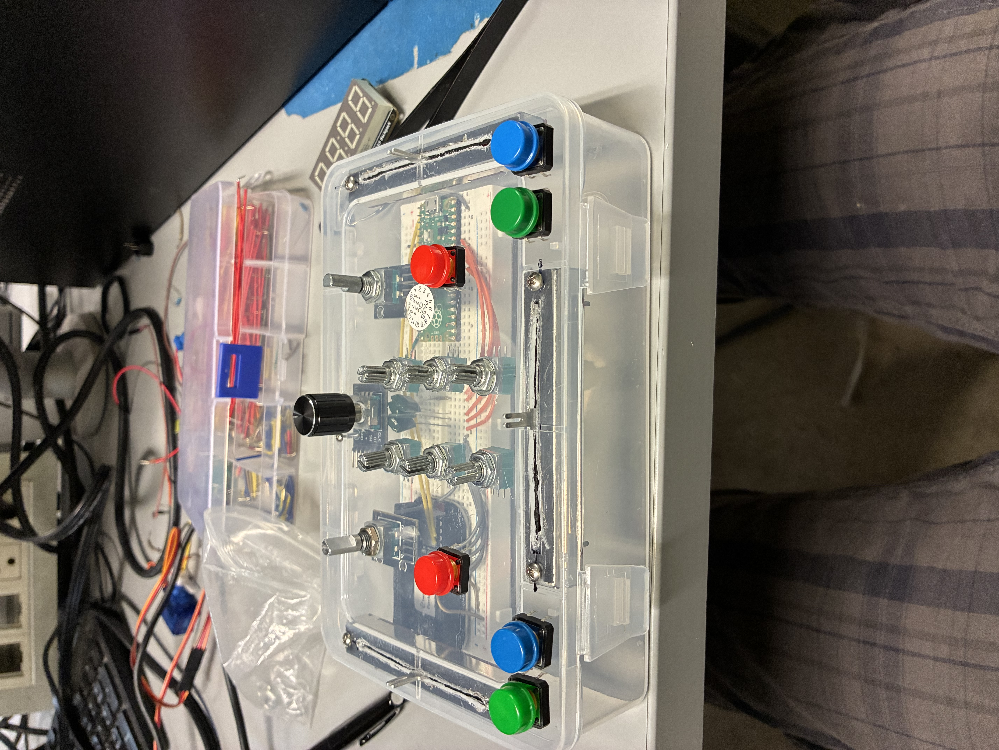
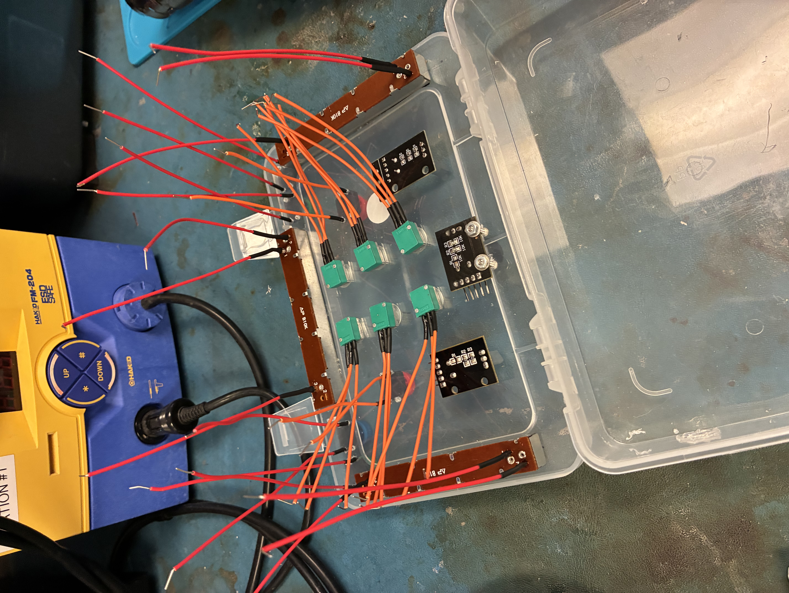
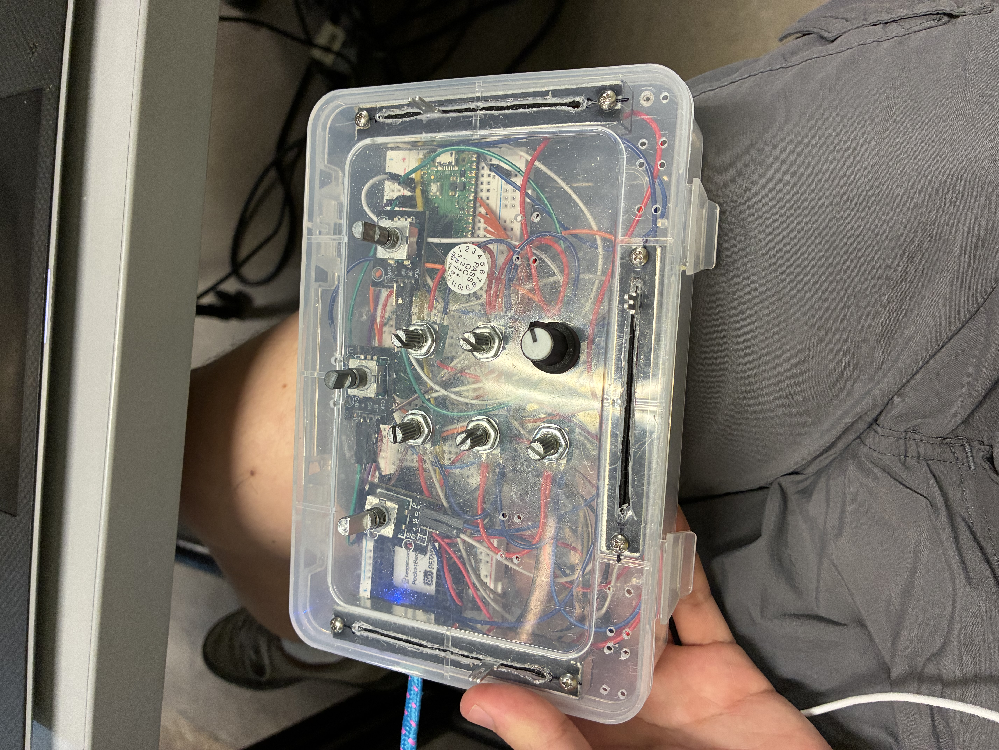
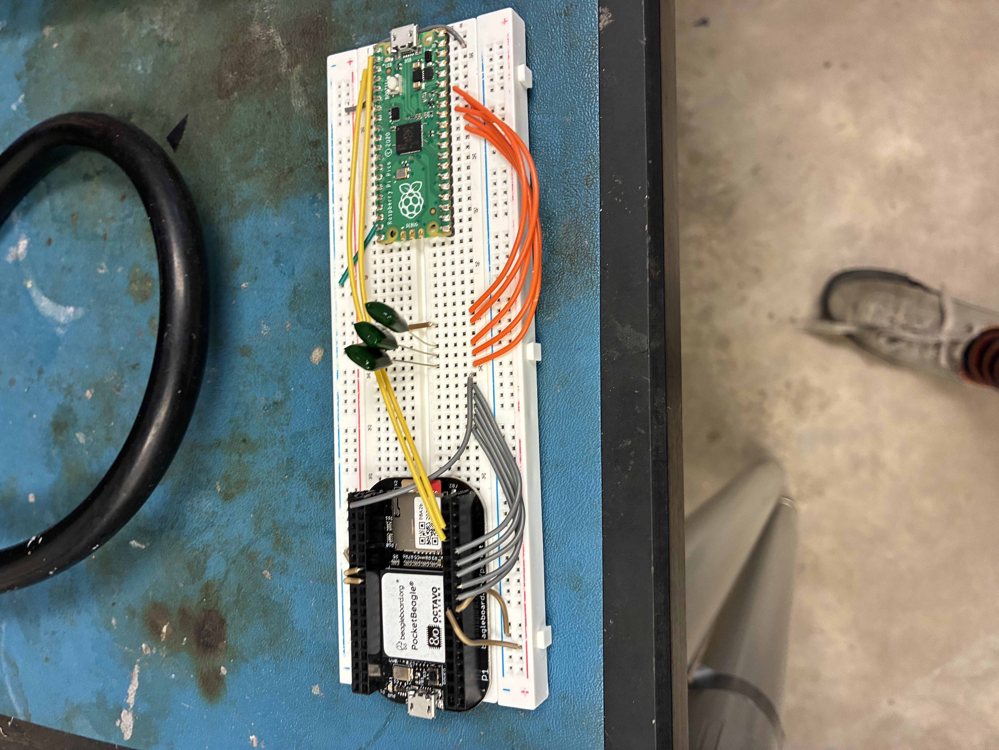
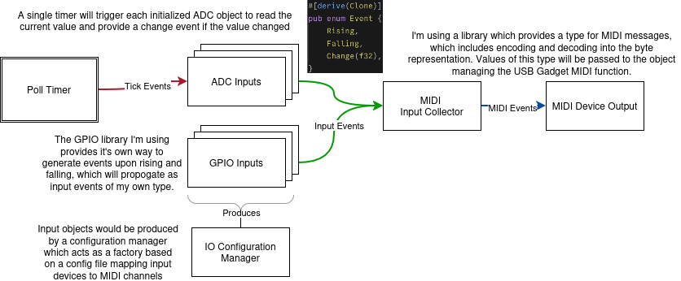

# Progress Report

## Hardware

I have assembled a plastic box with mounted input devices. I have found rotary and slide potentiometers which seem pretty satisfactory for this project. I have laid out the parts in a way that mirrors a conventional DJ Controller, with a crossfader, two tempo faders, 3 volume/EQ potentiometers, 3 rotary encoders, and buttons.

Here is my first attempt at soldering the parts. I was in a flow state late at night, and I just naively soldered a wire to all the pins of the parts. When I tried to put the parts together, I realized that there were too many wires, and it all bunched up when I tried to close the box.

I made a second attempt at soldering the parts, thinking more carefully about sharing power and ground for similar components. All the potentiometers are 10k linear, so I was able to group most of their power and ground. Same for the encoders and buttons, though I still need to solder the buttons.

Once I had enough parts soldered to test, I made a first iteration of the software with AI, just to try and get things working.

### Remaining Work

I decided on 9 analog inputs on the board, even though the pocketbeagle realistically supports 6. I figured I'll just have the six most essential ones, and then I'll try to get 3 more to work with a RPi Pico, which itself has 3 ADC inputs, and then communicate those to the pocketbeagle via UART or the like.

## Software

On the software side, I have decided to go with rust since it's a language I've been wanting to learn. Here is a table describing my dependencies.

| Dependency                                              | Description                                                                                                                                                      |
| ------------------------------------------------------- | ---------------------------------------------------------------------------------------------------------------------------------------------------------------- |
| [Rust](https://rust-lang.org/)                          | A programming language that has become a popular replacement for C/C++ as a systems or general purpose language.                                                 |
| [Tokio](https://crates.io/crates/tokio)                 | An asynchronous runtime I'm using to manage the event based nature of my application, for propogating UI events through a MIDI translation and out over USB I/O. |
| [wmidi](https://crates.io/crates/wmidi)                 | A Rust library providing a the `MidiMessage` type for representing and encoding MIDI messages.                                                                   |
| [industrial-io](https://crates.io/crates/industrial-io) | A Rust library abstracting Linux IIO (for ADC).                                                                                                                  |
| [gpiocdev](https://crates.io/crates/gpiocdev)           | A Rust library for interacting with Linux GPIO.                                                                                                                  |
| [Systemd](https://en.wikipedia.org/wiki/Systemd)        | Used for initialization, configuration, and logging of the application.                                                                                          |

Here is the software diagram:

I've decided on using the Tokio runtime to manage concurrency. This would simplify the application by having each component separately manage its own thread of execution, and pass events over a streams connecting each separate component asynchronously.
